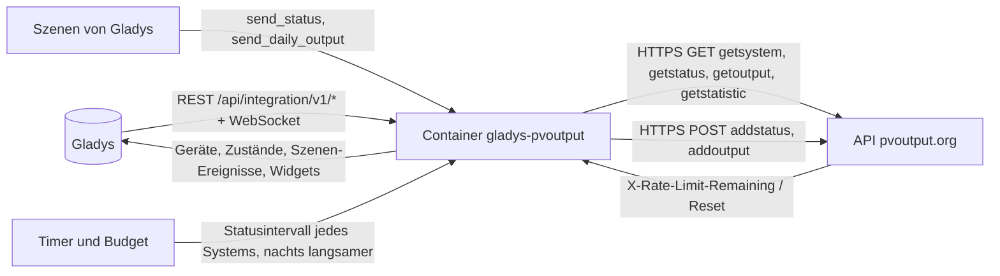
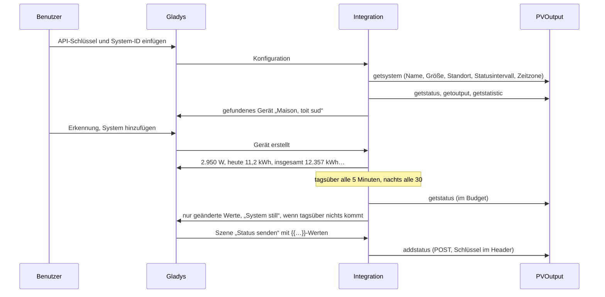
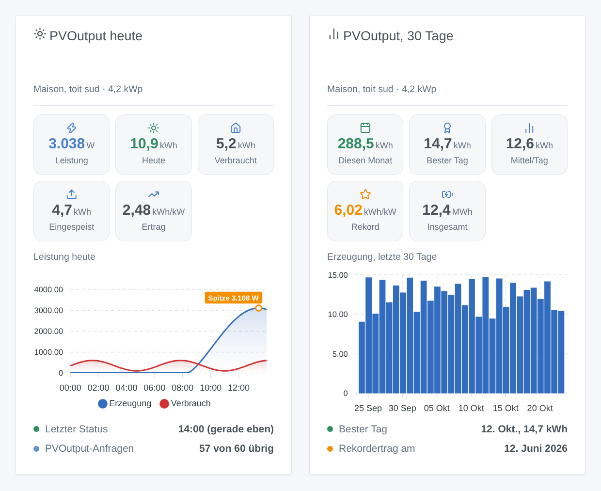

# Gladys PVOutput

[English](README.md) · [Français](README.fr.md) · **Deutsch** · [Español](README.es.md)

[](LICENSE)
[](https://github.com/William-De71/gladys-pvoutput/releases)
[](https://github.com/William-De71/gladys-pvoutput/actions/workflows/release.yml)
[](https://gladysassistant.com)


Externe Integration für [Gladys Assistant](https://gladysassistant.com) zu [PVOutput](https://pvoutput.org), dem kostenlosen Dienst, auf dem Besitzer von Solaranlagen ihre Erzeugung teilen und vergleichen. Sie bringt deine PVOutput-Systeme in Gladys (Erzeugung, Verbrauch, Rekorde, Tagesbilanz) und lässt deine Szenen Live-Status und Tageserträge aus beliebigen Werten von Gladys an PVOutput senden — über die offizielle API und deinen eigenen API-Schlüssel, innerhalb seines Kontingents von 60 Anfragen pro Stunde.

Benutzerdokumentation: [English](docs/en.md) · [Français](docs/fr.md) · [Deutsch](docs/de.md) · [Español](docs/es.md).

Nicht mit PVOutput verbunden. **Noch nicht mit einem echten PVOutput-Konto getestet**: Die Anfragen folgen der offiziellen API-Spezifikation, Antworten und Ablehnungen sind die dort dokumentierten; eine Anfrage mit falschem Schlüssel wurde real geprüft.

## Funktionen

- Bis zu **fünf Systeme** eines PVOutput-Kontos, über ihre System-ID, mit einem API-Schlüssel (ein Nur-Lese-Schlüssel liest; der Standardschlüssel sendet auch).
- **Ein Gerät pro System**, benannt wie auf PVOutput: erzeugte Leistung, heute erzeugte Energie, Gesamterzeugung, und verbrauchte Leistung und Energie von heute, Temperatur und Spannung, wenn das System sie veröffentlicht. Eine gefundene Funktion verschwindet nie.
- **5 Szenen-Auslöser** (System tagsüber still, System wieder da, Tagesbilanz nach Sonnenuntergang, Rekordtag, Schlüssel abgelehnt), **3 Szenen-Aktionen** (Status senden, Tagesertrag senden, Tag eines Systems lesen) und **2 Dashboard-Widgets** (ein System heute, seine letzten 30 Tage).
- **Im Kontingent des Schlüssels**: 60 Anfragen pro Stunde (300 im Spendenmodus) für alle Systeme zusammen, eine Reserve für deine Szenen, die Kontingent-Header von PVOutput beachtet, Pause bis zum Zurücksetzen, wenn es erreicht ist, seltenere Abfragen nachts (Sonnenauf- und -untergang an jedem System berechnet).
- Die Ortszeit jedes Systems: seine PVOutput-Zeitzone oder die von Gladys.
- Vier Sprachen überall: Englisch, Französisch, Deutsch, Spanisch.

## Funktionsweise




Vom Schlüssel zur Szene:



### Transport

`transports: ["cloud"]`: Alles läuft über `pvoutput.org`. **Dein API-Schlüssel, deine System-IDs und die Werte, die deine Szenen senden, verlassen dein Netz** in Richtung PVOutput; sonst nichts von Gladys. Schlüssel und System-ID gehen in Anfrage-Headern, nie in einer URL. `/data` speichert, was getsystem lieferte, den letzten Status, die Tageskurve, 31 Tage Erträge, die Statistik, die Anfragen der letzten Stunde und was die Auslöser wissen — nie den Schlüssel.

## Geräte und Funktionen

| Gerät           | Funktionen (Kategorie / Typ)                                                                                                                                                                                                                                                                                                                                                                                     |
| --------------- | ---------------------------------------------------------------------------------------------------------------------------------------------------------------------------------------------------------------------------------------------------------------------------------------------------------------------------------------------------------------------------------------------------------------- |
| Eins pro System | Solarerzeugung (`energy-production-sensor` / `power`, W), Erzeugung heute (`energy-production-sensor` / `daily-production`, kWh), Gesamterzeugung (`energy-production-sensor` / `index`, kWh); wenn veröffentlicht: Verbrauch (`energy-sensor` / `power`, W), Verbrauch heute (`energy-sensor` / `index-today`, kWh), Temperatur (`temperature-sensor` / `probe`, °C), Spannung (`energy-sensor` / `voltage`, V) |

- Die Leistung fällt nachts und an einem neuen Tag auf 0; ein tagsüber verspätetes System behält seinen letzten Wert (das Widget zeigt „still“).
- Die Gesamterzeugung ist ein **Erzeugungszählerstand**: Er speist den Verlauf von Gladys, nie den Verbrauch oder die Kosten des Energie-Dashboards; er sinkt nie.
- Der Verbrauch des Tages ist `index-today`, nicht `daily-consumption`: Gladys würde ihn bepreisen und doppelt mit dem Hauszähler zählen.
- Die Temperatur ist eine `probe`: Sie zählt nie zur Temperatur eines Raums.
- Keine Funktion für den Tagesertrag pro kWp (kWh/kWp hat keine Gladys-Einheit) noch für die Einspeisung des Tages (Gladys hat keinen täglichen Exporttyp): Beide stehen in den Widgets und Szenen.
- Die Grenzen der Erzeugungsfunktionen kommen aus der Systemgröße (PVOutput lehnt eine Leistung 50 % darüber und eine Energie über 12 kWh/kWp ab). Externe IDs beruhen auf der System-ID (`ext:pvoutput:system:12345`).

## Szenen-Auslöser, Aktionen und Widgets



**Widgets**: PVOutput heute (aktuelle Leistung, live sobald das Gerät existiert; Tagesenergie; Verbrauch oder Einspeisung, wenn veröffentlicht; Ertrag; Tageskurve mit Spitze; Zeit des letzten Status, oder still, oder Nacht; verbleibende Anfragen der Stunde) und PVOutput, 30 Tage (Balken der letzten 30 Tage, der Monat, der beste Tag, das Tagesmittel, der Rekordertrag und sein Datum, die Gesamterzeugung). Die Tageskurve wird nur gelesen, solange das Widget angezeigt wird, höchstens alle 15 Minuten.

**Auslöser** (ein Ereignis pro Übergang, nie bei der ersten Abfrage, nie als Folge einer Aktion):

- **System still**: kein neuer Status während 3 Statusintervallen (mindestens 30 Minuten), **während am System die Sonne scheint** — Wechselrichter veröffentlichen nachts nichts, die Nacht löst ihn also nie aus; **System wieder da**, wenn es wieder veröffentlicht;
- **Tagesbilanz**: einmal am Tag, etwa eine Stunde nach Sonnenuntergang am System: Erzeugung, Einspeisung, Verbrauch, Spitzenleistung und ihre Zeit, Ertrag, Wetterlage, Rekord oder nicht, und ein Satz;
- **Rekordtag**: Der Ertrag des Tages ist der Rekord des Systems (Statistik von PVOutput), mit dem bisherigen Rekord;
- **Schlüssel abgelehnt**: einmal pro Ablehnung (ungültig, deaktiviert oder nicht für diese Systeme).

Filter: das System. Die Werte (Leistung, Energie) sind Gerätefunktionen: „Erzeugung über 3 kW“ ist ein Geräte-Auslöser von Gladys.

**Aktionen**:

- **Status senden** (addstatus): erzeugte Leistung und Energie, verbrauchte Leistung und Energie, Temperatur, Spannung — Textfelder, die die `{{…}}`-Variablen des Szeneneditors annehmen (Gladys 5.1.0+), Zahlen wie `2 350` oder `12,4`; Energien in kWh (in Wh umgerechnet) oder Wh; Zählerstände (`c1`) oder Nettodaten (`n=1`); Datum und Zeit = jetzt, in der Zeitzone des Systems. Jedes Mal eine Anfrage des Kontingents: **Eine Szene alle 5 Minuten verbraucht 12 Anfragen pro Stunde**.
- **Tagesertrag senden** (addoutput): heute oder gestern, Erzeugung, Einspeisung, Verbrauch, Bezug Hoch- und Niedertarif (kWh, oder in Wh geschrieben), Tiefst- / Höchsttemperatur, Wetterlage, Kommentar.
- **Tag eines Systems lesen**: Erzeugung, Einspeisung, Verbrauch, Spitze, Ertrag, aktuelle Leistung, letzter Status und ein Satz, aus den letzten Abfragen (ohne Anfrage).

Beispiele:

- Alle 5 Minuten → letzten Wert der Wechselrichterleistung und seines Erzeugungszählers holen → **PVOutput: Status senden** mit Leistung `{{…}}`, Energie `{{…}}`, „Erzeugung ist ein Zählerstand“.
- Jeden Abend um 23:30 → Zählerwerte des Tages holen → **PVOutput: Tagesertrag senden** mit Einspeisung und Bezug.
- Wenn **PVOutput: System still** → Gladys-Benachrichtigung „Der Wechselrichter schweigt seit {{triggerEvent.data.last_status_time}}“ senden.
- Wenn **PVOutput: Tagesbilanz** → Nachricht „Heute: {{triggerEvent.data.production_kwh}} kWh“ senden.

## Voraussetzungen

- Gladys Assistant **5.1.0** oder neuer (Widgets und Szenen von Integrationen): Ältere Instanzen können die Integration nicht installieren.
- Ein (kostenloses) [PVOutput](https://pvoutput.org)-Konto mit aktiviertem **API Access** und seinem Schlüssel; die System-ID jedes Systems.
- Internet: Die Integration spricht nur mit `pvoutput.org`.

### Das Kontingent des Schlüssels

PVOutput erlaubt **60 Anfragen pro Stunde und API-Schlüssel** (300 im Spendenmodus) und 12 getstatistic pro Stunde (60). Das zählt alle Systeme und **alle Apps, die den Schlüssel nutzen** — ein Upload-Programm des Wechselrichters mit demselben Schlüssel teilt es. Die Integration folgt der echten Zählung, die PVOutput zurückgibt: tagsüber für ein System etwa 19 Anfragen pro Stunde (Status alle 5 Minuten, Erträge alle 30 Minuten, Statistik stündlich, die Kurve, solange ein Widget sie zeigt), nachts weniger; mit mehr Systemen werden die Intervalle länger. Sie hält immer 15 Anfragen pro Stunde (60 im Spendenmodus) für deine Szenen frei und pausiert bis zum Zurücksetzen, wenn PVOutput meldet, dass die Stunde aufgebraucht ist.

## Installation

- **Aus dem Store**: Integrationen → PVOutput → Installieren.
- **Über die URL des Repositorys**: Integrationen → externe Integration → `https://github.com/William-De71/gladys-pvoutput`.
- **Entwicklermodus**: `npm start` mit den von Gladys gelieferten Variablen starten (siehe Entwicklung).

## Konfiguration

| Feld oder Schaltfläche       | Standard    | Bedeutung                                                                                              |
| ---------------------------- | ----------- | ------------------------------------------------------------------------------------------------------ |
| API-Schlüssel                | —           | Pflicht, geheim: Settings → API Access → Enabled → New Key; Nur-Lese-Schlüssel nur zum Lesen           |
| System-ID(s)                 | —           | Pflicht: unter Registered Systems; mehrere durch Kommas getrennt, höchstens fünf                       |
| Spendenmodus                 | aus         | 300 statt 60 Anfragen pro Stunde (die Antworten von PVOutput korrigieren eine falsche Wahl)            |
| Sprache der Texte            | automatisch | Namen der Funktionen, Texte und Fehler der Szenen                                                      |
| Verbindung testen / Diagnose | —           | Name, Größe, Statusintervall, Zeitzone, verbleibende Anfragen; der Zustand in den Logs, ohne Schlüssel |

## Verwendung

1. Auf pvoutput.org: Settings → API Access → **Enabled** → **New Key** → Save; notiere die **System-ID** unter Registered Systems.
2. In Gladys (Integrationen → PVOutput → Konfiguration): Schlüssel und System-ID(s) einfügen; **Verbindung testen** drücken.
3. **Erkennung**, dann deine Systeme als Geräte hinzufügen.
4. Die Widgets zu einem Dashboard hinzufügen und Szenen mit den Funktionen, Auslösern und Aktionen bauen.

## Entwicklung

```bash
npm install
npm test                       # node --test, ein falsches PVOutput auf 127.0.0.1, nie das Netz
npm run lint                   # ESLint
npm run format:check           # Prettier
npx github:GladysAssistant/integration-store . --skip-image-check
scripts/build-cover.sh         # cover.jpg aus docs/assets/cover.svg
docs/illustrations/render.sh   # docs/assets/widgets.<lang>.png
```

Lokal liest das SDK `GLADYS_HOST_API_URL`, `GLADYS_INTEGRATION_TOKEN` und `GLADYS_INTEGRATION_SELECTOR` (von Gladys im Entwicklermodus geliefert), die Integration liest `TZ`. `DEBUG=gladys-integration-sdk` zeigt die Logs des SDK.

Die Tests decken den HTTP-Client (Header, GET und POST, jede Ablehnung der Spezifikation), den Parser (die Beispiele der Spezifikation, NaN, ein Komma im Namen, die doppelte Stunde bei der Zeitumstellung), Zeitzonen und Sonne, das Budget (Reserve, Header, Pause, Streckung), die Szenen-Aktionen (Zahlen, Einheiten, `c1` / `n`, Ablehnungen), die Auslöser (Stille nur tagsüber, eine Bilanz pro Tag, Rekorde), die Geräte (die Felder, die der Erkennungsbildschirm verlangt), die Widgets (`validateWidgetContent`), das Manifest, die vier Sprachen, das Release-Skript und die ganze Integration gegen das falsche Gladys des SDK und einen falschen PVOutput-HTTP-Server ab. `test/structure.test.js` friert alle von Benutzern gespeicherten Schlüssel ein.

## Release-Prozess


Jeder Merge auf `main` startet die CI und berechnet dann die Version aus den [Conventional Commits](https://www.conventionalcommits.org/) seit dem letzten Tag: `feat` → Minor, `fix` / `perf` → Patch, `!` oder `BREAKING CHANGE` → Major (ein Minor unter 1.0.0); `docs`, `chore`, `ci`, `test`, `style`, `refactor`, `build` allein veröffentlichen nichts. Der Changelog-Abschnitt wird erzeugt, der Tag gepusht, das Multi-Architektur-Image gebaut, dann erhält `main` den Release-Commit, die GitHub Release wird erstellt und ein letzter Job prüft das öffentliche Image, den Store-Validator und das Topic.

- Der Titel des Pull Requests wird zum Squash-Commit und dann zur Changelog-Zeile: Schreibe ihn auf Englisch, für den Benutzer (`pr-title.yml` prüft ihn). `CHANGELOG.md` nie von Hand bearbeiten.
- 1.0.0 ist eine Entscheidung: Actions → Release → Run workflow mit `release-as: 1.0.0`. `dry-run` zeigt Version und Notizen ohne Veröffentlichung.
- **Geschützter Branch**: Das Release pusht seinen Commit mit `GITHUB_TOKEN` auf `main`. Das Ruleset `protect-main` (kein Löschen, kein Force-Push) lässt ihn durch; eine strengere Regel (Pull Request Pflicht, Status-Checks) bräuchte GitHub Actions in der Bypass-Liste oder eine GitHub App.
- Nach dem ersten Release das `ghcr.io`-Paket öffentlich machen (Package settings → Change visibility), sonst kann Gladys es nicht laden.

## Fehlerbehebung

Siehe [docs/de.md](docs/de.md#fehlerbehebung). Melde Probleme mit den Versionen von Gladys und der Integration, der Meldung von **Verbindung testen** und dem Ergebnis von **Diagnose** (in den Logs der Integration). Füge nie deinen Schlüssel ein.

## Mitwirken

Issues und Pull Requests sind willkommen. Führe vor einem Pull Request `npm run format:check && npm run lint && npm test` aus und lass alle externen IDs und gespeicherten Schlüssel unverändert (siehe [CLAUDE.md](CLAUDE.md)).

## Sicherheit

Siehe [SECURITY.md](SECURITY.md): Melde Schwachstellen vertraulich. Der Schlüssel ist ein `secret`-Feld: nie geloggt, nie in `/data` geschrieben, nur an `pvoutput.org` in einem Anfrage-Header gesendet, nie in einer URL.

## Kommende Screenshots

Die Bilder oben sind Illustrationen, keine Screenshots. Echte Screenshots kommen nach `docs/assets/screenshots/` (PNG, 1280 × 800): `configuration.png`, `discovery.png`, `device.png` (ein System mit seinen Funktionen), `scene-send-status.png` (die Aktion „Status senden“ mit `{{…}}`-Variablen).

## Lizenz

[Apache License 2.0](LICENSE) — siehe auch [NOTICE](NOTICE). Die Daten gehören den Besitzern der Systeme; PVOutput.org wird von seinen eigenen Autoren betrieben. Danke an die Dokumentation und das SDK von Gladys und an PVOutput für seine offene API.
