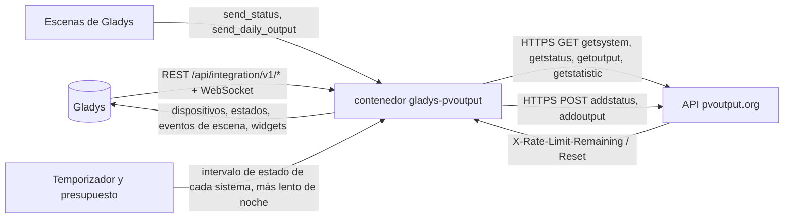
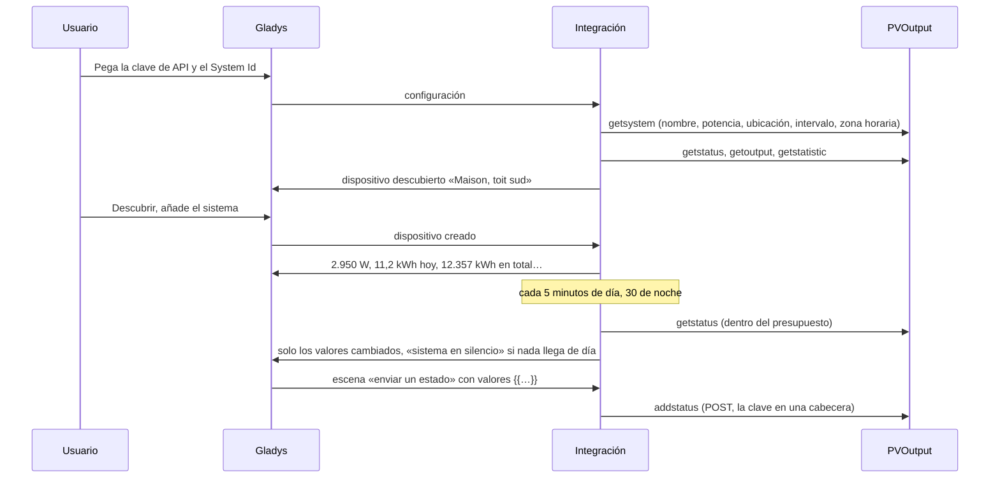
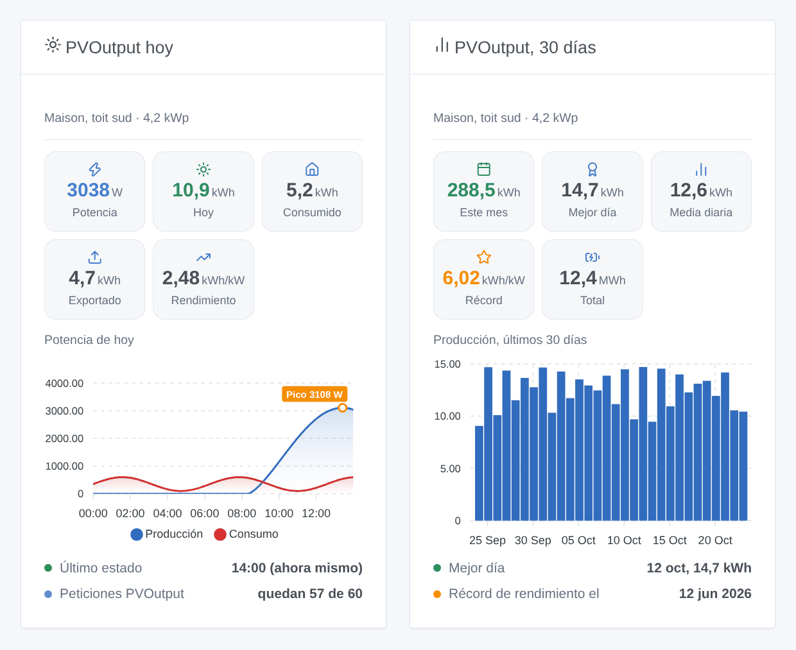

# Gladys PVOutput

[English](README.md) · [Français](README.fr.md) · [Deutsch](README.de.md) · **Español**

[](LICENSE)
[](https://github.com/William-De71/gladys-pvoutput/releases)
[](https://github.com/William-De71/gladys-pvoutput/actions/workflows/release.yml)
[](https://gladysassistant.com)


Integración externa de [Gladys Assistant](https://gladysassistant.com) para [PVOutput](https://pvoutput.org), el servicio gratuito donde los propietarios de instalaciones solares comparten y comparan su producción. Trae sus sistemas PVOutput a Gladys (producción, consumo, récords, balance del día) y permite que sus escenas envíen estados en directo y producciones diarias a PVOutput desde cualquier valor de Gladys, mediante la API oficial y su propia clave, dentro de su cuota de 60 peticiones por hora.

Documentación de usuario: [English](docs/en.md) · [Français](docs/fr.md) · [Deutsch](docs/de.md) · [Español](docs/es.md).

No afiliada a PVOutput. **Aún no probada con una cuenta PVOutput real**: las peticiones siguen la especificación oficial de la API, las respuestas y rechazos son los que documenta; una petición con una clave falsa se comprobó de verdad.

## Funciones

- Hasta **cinco sistemas** de una cuenta PVOutput, por su System Id, con una sola clave de API (una clave de solo lectura lee; la clave estándar también envía).
- **Un dispositivo por sistema**, con el nombre que tiene en PVOutput: potencia producida, energía producida hoy, producción total, y potencia y energía consumidas hoy, temperatura y tensión cuando el sistema las publica. Una función encontrada nunca desaparece.
- **5 activadores de escena** (sistema en silencio de día, sistema de vuelta, balance del día tras la puesta de sol, día récord, clave rechazada), **3 acciones de escena** (enviar un estado, enviar la producción de un día, leer el día de un sistema) y **2 widgets** (un sistema hoy, sus últimos 30 días).
- **Dentro de la cuota de la clave**: 60 peticiones por hora (300 en modo donación) para todos los sistemas juntos, una reserva para sus escenas, las cabeceras de cuota de PVOutput respetadas, una pausa hasta el reinicio cuando se alcanza, lecturas más espaciadas de noche (salida y puesta de sol calculadas en cada sistema).
- La hora local de cada sistema: su zona horaria de PVOutput, o la de Gladys.
- Cuatro idiomas en todo: inglés, francés, alemán, español.

## Funcionamiento




De la clave a una escena:



### Transporte

`transports: ["cloud"]`: todo pasa por `pvoutput.org`. **Su clave de API, sus System Id y los valores que envían sus escenas salen de su red** hacia PVOutput; nada más de Gladys. La clave y el System Id viajan en cabeceras de la petición, nunca en una URL. `/data` guarda lo que dijo getsystem, el último estado, la curva del día, 31 días de producciones, las estadísticas, las peticiones de la última hora y lo que saben los activadores — nunca la clave.

## Dispositivos y funciones

| Dispositivo     | Funciones (categoría / tipo)                                                                                                                                                                                                                                                                                                                                                                                  |
| --------------- | ------------------------------------------------------------------------------------------------------------------------------------------------------------------------------------------------------------------------------------------------------------------------------------------------------------------------------------------------------------------------------------------------------------- |
| Uno por sistema | Producción solar (`energy-production-sensor` / `power`, W), producción de hoy (`energy-production-sensor` / `daily-production`, kWh), producción total (`energy-production-sensor` / `index`, kWh); si se publican: consumo (`energy-sensor` / `power`, W), consumo de hoy (`energy-sensor` / `index-today`, kWh), temperatura (`temperature-sensor` / `probe`, °C), tensión (`energy-sensor` / `voltage`, V) |

- La potencia cae a 0 de noche y al empezar un nuevo día; un sistema retrasado de día conserva su último valor (el widget indica «en silencio»).
- La producción total es un **índice de producción**: alimenta el historial de Gladys, nunca el consumo ni el coste del panel de energía; nunca baja.
- El consumo del día es `index-today`, no `daily-consumption`: Gladys le pondría precio y lo contaría dos veces con el contador de la vivienda.
- La temperatura es una `probe`: nunca cuenta en la temperatura de una habitación.
- No hay función para el rendimiento del día (el kWh/kWp no tiene unidad en Gladys) ni para la exportación del día (Gladys no tiene tipo de exportación diaria): ambos están en los widgets y las escenas.
- Los límites de las funciones de producción vienen de la potencia del sistema (PVOutput rechaza una potencia un 50 % superior y una energía por encima de 12 kWh/kWp). Los identificadores externos se basan en el System Id (`ext:pvoutput:system:12345`).

## Activadores, acciones y widgets



**Widgets**: PVOutput hoy (potencia actual, en directo una vez creado el dispositivo; energía del día; consumo o exportación si se publican; rendimiento; curva del día con su pico; hora del último estado, o en silencio, o noche; peticiones restantes de la hora) y PVOutput, 30 días (barras de los últimos 30 días, el mes, el mejor día, la media diaria, el récord de rendimiento y su fecha, la producción total). La curva del día solo se lee mientras se muestra el widget, cada 15 minutos como mucho.

**Activadores** (un evento por transición, nunca en la primera lectura, nunca como consecuencia de una acción):

- **sistema en silencio**: ningún estado nuevo durante 3 intervalos de estado (30 minutos como mínimo) **con el sol salido** en el sistema — los inversores no publican nada de noche, así que la noche nunca lo activa; **sistema de vuelta** cuando vuelve a publicar;
- **balance del día**: una vez al día, una hora después de la puesta de sol en el sistema: producción, exportación, consumo, potencia pico y su hora, rendimiento, condición, récord o no, y una frase;
- **día récord**: el rendimiento del día es el récord de la vida del sistema (estadísticas de PVOutput), con el récord anterior;
- **clave rechazada**: una vez por rechazo (no válida, desactivada o no es la de estos sistemas).

Filtro: el sistema. Los valores (potencia, energía) son funciones de dispositivo: «producción por encima de 3 kW» es un activador de dispositivo de Gladys.

**Acciones**:

- **enviar un estado** (addstatus): potencia y energía producidas, potencia y energía consumidas, temperatura, tensión — campos de texto que aceptan las variables `{{…}}` del editor de escenas (Gladys 5.1.0+), números como `2 350` o `12,4`; energías en kWh (convertidas a Wh) o Wh; índices acumulados (`c1`) o datos netos (`n=1`); fecha y hora = ahora, en la zona horaria del sistema. Cada vez una petición de la cuota: **una escena cada 5 minutos consume 12 peticiones por hora**.
- **enviar la producción de un día** (addoutput): hoy o ayer, producción, exportación, consumo, importación en punta y en valle (kWh, o escritas en Wh), temperaturas mín / máx, condición, comentario.
- **leer el día de un sistema**: producción, exportación, consumo, pico, rendimiento, potencia actual, último estado y una frase, según las últimas lecturas (sin petición).

Ejemplos:

- Cada 5 minutos → obtener el último valor de la potencia del inversor y de su índice de producción → **PVOutput: enviar un estado** con potencia `{{…}}`, energía `{{…}}`, «La producción es un índice».
- Cada noche a las 23:30 → obtener los valores del contador del día → **PVOutput: enviar la producción de un día** con la exportación y la importación.
- Cuando **PVOutput: sistema en silencio** → enviar una notificación de Gladys «El inversor no responde desde las {{triggerEvent.data.last_status_time}}».
- Cuando **PVOutput: balance del día** → enviar el mensaje «Hoy: {{triggerEvent.data.production_kwh}} kWh».

## Requisitos

- Gladys Assistant **5.1.0** o posterior (widgets y escenas de las integraciones): las instancias más antiguas no pueden instalar la integración.
- Una cuenta [PVOutput](https://pvoutput.org) (gratuita) con **API Access** activado y su clave; el System Id de cada sistema.
- Internet: la integración solo habla con `pvoutput.org`.

### La cuota de la clave

PVOutput acepta **60 peticiones por hora y clave de API** (300 en modo donación), y 12 getstatistic por hora (60). Esto cuenta todos los sistemas y **todas las aplicaciones que usan la clave** — un programa de envío del inversor con la misma clave la comparte. La integración sigue el recuento real que devuelve PVOutput: de día, para un sistema, unas 19 peticiones por hora (estado cada 5 minutos, producciones cada 30 minutos, estadísticas cada hora, la curva mientras un widget la muestra), menos de noche; con más sistemas los intervalos se alargan. Siempre reserva 15 peticiones por hora (60 en modo donación) para sus escenas, y se pausa hasta el reinicio cuando PVOutput indica que la hora está agotada.

## Instalación

- **Desde la tienda**: Integraciones → PVOutput → Instalar.
- **Desde la URL del repositorio**: Integraciones → integración externa → `https://github.com/William-De71/gladys-pvoutput`.
- **Modo desarrollador**: ejecutar `npm start` con las variables que da Gladys (ver Desarrollo).

## Configuración

| Campo o botón                    | Por defecto | Significado                                                                                            |
| -------------------------------- | ----------- | ------------------------------------------------------------------------------------------------------ |
| Clave de API                     | —           | Obligatoria, secreta: Settings → API Access → Enabled → New Key; de solo lectura para solo leer        |
| System Id(s)                     | —           | Obligatorio: en Registered Systems; varios separados por comas, cinco como máximo                      |
| Modo donación                    | desactivado | 300 peticiones por hora en lugar de 60 (las respuestas de PVOutput corrigen una elección errónea)      |
| Idioma de los textos             | automático  | Nombres de las funciones, textos y errores de las escenas                                              |
| Probar la conexión / Diagnóstico | —           | Nombre, potencia, intervalo, zona horaria, peticiones restantes; el estado en los registros, sin clave |

## Uso

1. En pvoutput.org: Settings → API Access → **Enabled** → **New Key** → Save; anote el **System Id** en Registered Systems.
2. En Gladys (Integraciones → PVOutput → Configuración): pegue la clave y el o los System Id; pulse **Probar la conexión**.
3. **Descubrir**, luego añada sus sistemas como dispositivos.
4. Añada los widgets a un panel y cree escenas con las funciones, los activadores y las acciones.

## Desarrollo

```bash
npm install
npm test                       # node --test, un PVOutput falso en 127.0.0.1, nunca la red
npm run lint                   # ESLint
npm run format:check           # Prettier
npx github:GladysAssistant/integration-store . --skip-image-check
scripts/build-cover.sh         # cover.jpg desde docs/assets/cover.svg
docs/illustrations/render.sh   # docs/assets/widgets.<lang>.png
```

En local, el SDK lee `GLADYS_HOST_API_URL`, `GLADYS_INTEGRATION_TOKEN` y `GLADYS_INTEGRATION_SELECTOR` (dados por Gladys en modo desarrollador), y la integración lee `TZ`. `DEBUG=gladys-integration-sdk` muestra los registros del SDK.

Las pruebas cubren el cliente HTTP (cabeceras, GET y POST, cada rechazo de la especificación), el analizador (los ejemplos de la especificación, NaN, una coma en un nombre, la hora repetida al cambiar al horario de invierno), las zonas horarias y el sol, el presupuesto (reserva, cabeceras, pausa, estiramiento), las acciones de escena (números, unidades, `c1` / `n`, rechazos), los activadores (silencio solo de día, un balance al día, récords), los dispositivos (los campos que exige la pantalla Descubrir), los widgets (`validateWidgetContent`), el manifiesto, los cuatro idiomas, el script de release y la integración completa frente al Gladys falso del SDK y un servidor HTTP PVOutput falso. `test/structure.test.js` congela todas las claves que guardan los usuarios.

## Proceso de release


Cada fusión en `main` ejecuta la CI y calcula la versión a partir de los [Conventional Commits](https://www.conventionalcommits.org/) desde la última etiqueta: `feat` → menor, `fix` / `perf` → parche, `!` o `BREAKING CHANGE` → mayor (una menor por debajo de 1.0.0); `docs`, `chore`, `ci`, `test`, `style`, `refactor`, `build` solos no publican nada. Se genera la sección del changelog, se sube la etiqueta, se construye la imagen multiarquitectura, luego `main` recibe el commit de release, se crea la GitHub Release y un último job comprueba la imagen pública, el validador de la tienda y el topic.

- El título de la pull request se convierte en el commit squash y luego en la línea del changelog: escríbalo en inglés, para el usuario (`pr-title.yml` lo comprueba). Nunca edite `CHANGELOG.md` a mano.
- La 1.0.0 es una decisión: Actions → Release → Run workflow con `release-as: 1.0.0`. `dry-run` muestra la versión y las notas sin publicar.
- **Rama protegida**: la release sube su commit a `main` con `GITHUB_TOKEN`. El ruleset `protect-main` (sin borrado, sin force-push) lo deja pasar; una regla más estricta (pull request obligatoria, status checks) necesitaría GitHub Actions en la lista de excepciones, o una GitHub App.
- Tras la primera release, haga público el paquete `ghcr.io` (Package settings → Change visibility), o Gladys no podrá descargarlo.

## Solución de problemas

Ver [docs/es.md](docs/es.md#solución-de-problemas). Informe de problemas con las versiones de Gladys y de la integración, el mensaje de **Probar la conexión** y el resultado de **Diagnóstico** (en los registros de la integración). Nunca pegue su clave.

## Contribuir

Issues y pull requests son bienvenidas. Ejecute `npm run format:check && npm run lint && npm test` antes de abrir una pull request, y no cambie ningún identificador externo ni clave guardada (ver [CLAUDE.md](CLAUDE.md)).

## Seguridad

Ver [SECURITY.md](SECURITY.md): informe de vulnerabilidades en privado. La clave es un campo `secret`: nunca registrada, nunca escrita en `/data`, enviada solo a `pvoutput.org` en una cabecera de la petición, nunca en una URL.

## Capturas por venir

Las imágenes de arriba son ilustraciones, no capturas de pantalla. Las capturas reales irán en `docs/assets/screenshots/` (PNG, 1280 × 800): `configuration.png`, `discovery.png`, `device.png` (un sistema con sus funciones), `scene-send-status.png` (la acción «enviar un estado» con variables `{{…}}`).

## Licencia

[Licencia Apache 2.0](LICENSE) — ver también [NOTICE](NOTICE). Los datos pertenecen a los propietarios de los sistemas; PVOutput.org lo gestionan sus propios autores. Gracias a la documentación y al SDK de Gladys, y a PVOutput por su API abierta.
