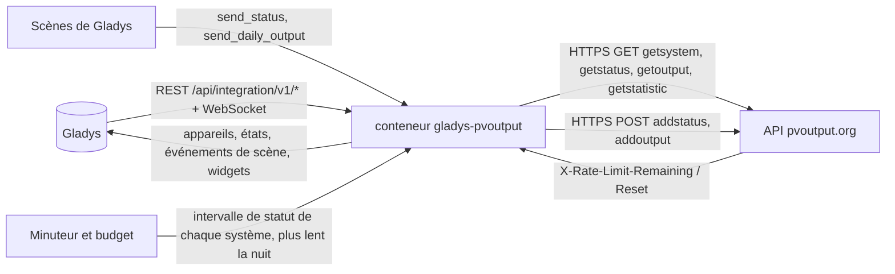
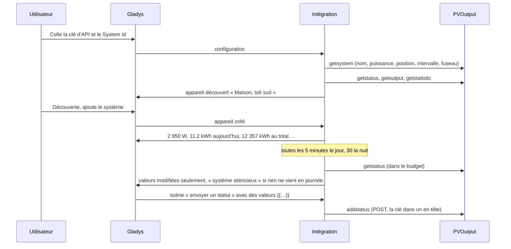
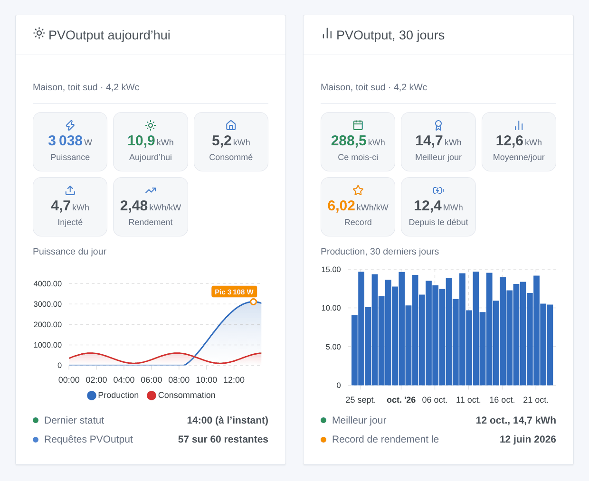

# Gladys PVOutput

[English](README.md) · **Français** · [Deutsch](README.de.md) · [Español](README.es.md)

[](LICENSE)
[](https://github.com/William-De71/gladys-pvoutput/releases)
[](https://github.com/William-De71/gladys-pvoutput/actions/workflows/release.yml)
[](https://gladysassistant.com)


Intégration externe [Gladys Assistant](https://gladysassistant.com) pour [PVOutput](https://pvoutput.org), le service gratuit où les propriétaires d’installations solaires partagent et comparent leur production. Elle amène vos systèmes PVOutput dans Gladys (production, consommation, records, bilan du jour) et permet à vos scènes d’envoyer des statuts en direct et des productions journalières à PVOutput depuis n’importe quelle valeur de Gladys, par l’API officielle et votre propre clé, dans la limite de son quota de 60 requêtes par heure.

Documentation utilisateur : [English](docs/en.md) · [Français](docs/fr.md) · [Deutsch](docs/de.md) · [Español](docs/es.md).

Non affiliée à PVOutput. **Pas encore testée avec un vrai compte PVOutput** : les requêtes suivent la spécification officielle de l’API, les réponses et refus sont ceux qu’elle documente ; une requête avec une fausse clé a été vérifiée en vrai.

## Fonctionnalités

- Jusqu’à **cinq systèmes** d’un compte PVOutput, par leur System Id, avec une seule clé d’API (une clé en lecture seule lit ; la clé standard permet aussi d’envoyer).
- **Un appareil par système**, nommé comme sur PVOutput : puissance produite, énergie produite du jour, production totale, et puissance et énergie consommées du jour, température et tension quand le système les publie. Une fonctionnalité trouvée ne disparaît jamais.
- **5 déclencheurs de scène** (système silencieux en journée, retour du système, bilan du jour après le coucher du soleil, journée record, clé refusée), **3 actions de scène** (envoyer un statut, envoyer la production d’un jour, lire la journée d’un système) et **2 widgets** (un système aujourd’hui, ses 30 derniers jours).
- **Dans le quota de la clé** : 60 requêtes par heure (300 en mode donation) pour tous les systèmes ensemble, une réserve gardée pour vos scènes, les en-têtes de quota de PVOutput suivis, une pause jusqu’à la remise à zéro quand il est atteint, des lectures espacées la nuit (lever et coucher du soleil calculés à chaque système).
- L’heure locale de chaque système : son fuseau PVOutput, ou celui de Gladys.
- Quatre langues partout : anglais, français, allemand, espagnol.

## Fonctionnement




De la clé à une scène :



### Transport

`transports: ["cloud"]` : tout passe par `pvoutput.org`. **Votre clé d’API, vos System Id et les valeurs envoyées par vos scènes quittent votre réseau** vers PVOutput ; rien d’autre de Gladys. La clé et le System Id voyagent dans des en-têtes de requête, jamais dans une URL. `/data` garde ce que getsystem a dit, le dernier statut, la courbe du jour, 31 jours de productions, les statistiques, les requêtes de la dernière heure et ce que savent les déclencheurs — jamais la clé.

## Appareils et fonctionnalités

| Appareil       | Fonctionnalités (catégorie / type)                                                                                                                                                                                                                                                                                                                                                                                          |
| -------------- | --------------------------------------------------------------------------------------------------------------------------------------------------------------------------------------------------------------------------------------------------------------------------------------------------------------------------------------------------------------------------------------------------------------------------- |
| Un par système | Production solaire (`energy-production-sensor` / `power`, W), production du jour (`energy-production-sensor` / `daily-production`, kWh), production totale (`energy-production-sensor` / `index`, kWh) ; si publiées : consommation (`energy-sensor` / `power`, W), consommation du jour (`energy-sensor` / `index-today`, kWh), température (`temperature-sensor` / `probe`, °C), tension (`energy-sensor` / `voltage`, V) |

- La puissance tombe à 0 la nuit et au début d’une nouvelle journée ; un système en retard en journée garde sa dernière valeur (le widget indique « silencieux »).
- La production totale est un **index de production** : il alimente l’historique de Gladys, jamais la consommation ni le coût du tableau de bord énergie ; il ne redescend jamais.
- La consommation du jour est `index-today`, pas `daily-consumption` : Gladys la valoriserait et la compterait deux fois avec le compteur de la maison.
- La température est une `probe` : elle ne compte jamais dans la température d’une pièce.
- Pas de fonctionnalité pour le rendement du jour (le kWh/kWc n’a pas d’unité Gladys) ni pour l’injection du jour (Gladys n’a pas de type d’export journalier) : les deux sont dans les widgets et les scènes.
- Les bornes des fonctionnalités de production viennent de la puissance du système (PVOutput refuse une puissance supérieure de 50 % et une énergie au-delà de 12 kWh/kWc). Les identifiants externes reposent sur le System Id (`ext:pvoutput:system:12345`).

## Déclencheurs, actions et widgets



**Widgets** : PVOutput aujourd’hui (puissance actuelle, en direct une fois l’appareil créé ; énergie du jour ; consommation ou injection si publiées ; rendement ; courbe du jour avec son pic ; heure du dernier statut, ou silencieux, ou nuit ; requêtes restantes de l’heure) et PVOutput, 30 jours (barres des 30 derniers jours, le mois, le meilleur jour, la moyenne, le record de rendement et sa date, la production totale). La courbe du jour n’est lue que quand le widget est affiché, toutes les 15 minutes au plus.

**Déclencheurs** (un événement par transition, jamais à la première lecture, jamais en conséquence d’une action) :

- **système silencieux** : aucun nouveau statut pendant 3 intervalles de statut (30 minutes au moins) **alors que le soleil est levé** au système — les onduleurs ne publient rien la nuit, la nuit ne le déclenche donc jamais ; **retour du système** quand il publie de nouveau ;
- **bilan du jour** : une fois par jour, environ une heure après le coucher du soleil au système : production, injection, consommation, pic et son heure, rendement, condition, record ou non, et une phrase ;
- **journée record** : le rendement du jour est le record de la vie du système (statistiques PVOutput), avec le record précédent ;
- **clé refusée** : une fois par refus (invalide, désactivée, ou pas celle de ces systèmes).

Filtre : le système. Les valeurs (puissance, énergie) sont des fonctionnalités : « production au-dessus de 3 kW » est un déclencheur d’appareil de Gladys.

**Actions** :

- **envoyer un statut** (addstatus) : puissance et énergie produites, puissance et énergie consommées, température, tension — des champs texte qui acceptent les variables `{{…}}` de l’éditeur de scène (Gladys 5.1.0+), des nombres comme `2 350` ou `12,4` ; énergies en kWh (converties en Wh) ou en Wh ; index cumulés (`c1`) ou données nettes (`n=1`) ; date et heure = maintenant, dans le fuseau du système. Une requête du quota à chaque fois : **une scène toutes les 5 minutes consomme 12 requêtes par heure**.
- **envoyer la production d’un jour** (addoutput) : aujourd’hui ou hier, production, injection, consommation, soutirage heures pleines et creuses (kWh, ou écrits en Wh), températures min / max, condition, commentaire.
- **lire la journée d’un système** : production, injection, consommation, pic, rendement, puissance actuelle, dernier statut et une phrase, d’après les dernières lectures (sans requête).

Exemples :

- Toutes les 5 minutes → récupérer la dernière valeur de la puissance de l’onduleur et de son index de production → **PVOutput : envoyer un statut** avec puissance `{{…}}`, énergie `{{…}}`, « La production est un index ».
- Chaque soir à 23 h 30 → récupérer les valeurs Linky du jour → **PVOutput : envoyer la production d’un jour** avec l’injection et le soutirage.
- Quand **PVOutput : système silencieux** → envoyer une notification Gladys « L’onduleur est muet depuis {{triggerEvent.data.last_status_time}} ».
- Quand **PVOutput : bilan du jour** → envoyer le message « Aujourd’hui : {{triggerEvent.data.production_kwh}} kWh ».

## Prérequis

- Gladys Assistant **5.1.0** ou plus récent (widgets et scènes des intégrations) : les instances plus anciennes ne peuvent pas installer l’intégration.
- Un compte [PVOutput](https://pvoutput.org) (gratuit) avec **API Access** activé et sa clé ; le System Id de chaque système.
- Internet : l’intégration ne parle qu’à `pvoutput.org`.

### Le quota de la clé

PVOutput accepte **60 requêtes par heure et par clé d’API** (300 en mode donation), et 12 getstatistic par heure (60). Cela compte tous les systèmes et **toutes les applications qui utilisent la clé** — un logiciel d’envoi de l’onduleur qui utilise la même clé la partage. L’intégration suit le décompte réel renvoyé par PVOutput : en journée, pour un système, environ 19 requêtes par heure (statut toutes les 5 minutes, productions toutes les 30 minutes, statistiques toutes les heures, la courbe quand un widget l’affiche), moins la nuit ; avec plus de systèmes, les intervalles s’allongent. Elle garde toujours 15 requêtes par heure (60 en mode donation) pour vos scènes, et se met en pause jusqu’à la remise à zéro quand PVOutput indique que l’heure est épuisée.

## Installation

- **Depuis le store** : Intégrations → PVOutput → Installer.
- **Depuis l’URL du dépôt** : Intégrations → intégration externe → `https://github.com/William-De71/gladys-pvoutput`.
- **Mode développeur** : lancer `npm start` avec les variables fournies par Gladys (voir Développement).

## Configuration

| Champ ou bouton                  | Défaut      | Rôle                                                                                                 |
| -------------------------------- | ----------- | ---------------------------------------------------------------------------------------------------- |
| Clé d’API                        | —           | Obligatoire, secrète : Settings → API Access → Enabled → New Key ; lecture seule pour seulement lire |
| System Id(s)                     | —           | Obligatoire : sous Registered Systems ; plusieurs séparés par des virgules, cinq au plus             |
| Mode donation                    | désactivé   | 300 requêtes par heure au lieu de 60 (les réponses de PVOutput corrigent un mauvais choix)           |
| Langue des textes                | automatique | Noms des fonctionnalités, textes et erreurs des scènes                                               |
| Tester la connexion / Diagnostic | —           | Nom, puissance, intervalle, fuseau, requêtes restantes ; l’état dans les journaux, sans la clé       |

## Utilisation

1. Sur pvoutput.org : Settings → API Access → **Enabled** → **New Key** → Save ; notez le **System Id** sous Registered Systems.
2. Dans Gladys (Intégrations → PVOutput → Configuration) : collez la clé et le ou les System Id ; appuyez sur **Tester la connexion**.
3. **Découverte**, puis ajoutez vos systèmes comme appareils.
4. Ajoutez les widgets à un tableau de bord, et construisez des scènes avec les fonctionnalités, les déclencheurs et les actions.

## Développement

```bash
npm install
npm test                       # node --test, un faux PVOutput sur 127.0.0.1, jamais le réseau
npm run lint                   # ESLint
npm run format:check           # Prettier
npx github:GladysAssistant/integration-store . --skip-image-check
scripts/build-cover.sh         # cover.jpg depuis docs/assets/cover.svg
docs/illustrations/render.sh   # docs/assets/widgets.<lang>.png
```

En local, le SDK lit `GLADYS_HOST_API_URL`, `GLADYS_INTEGRATION_TOKEN` et `GLADYS_INTEGRATION_SELECTOR` (fournis par Gladys en mode développeur), et l’intégration lit `TZ`. `DEBUG=gladys-integration-sdk` affiche les journaux du SDK.

Les tests couvrent le client HTTP (en-têtes, GET et POST, chaque refus de la spécification), le parseur (les exemples de la spécification, NaN, une virgule dans un nom, l’heure répétée au passage à l’heure d’hiver), les fuseaux et le soleil, le budget (réserve, en-têtes, pause, étirement), les actions de scène (nombres, unités, `c1` / `n`, refus), les déclencheurs (silence en journée seulement, un bilan par jour, records), les appareils (les champs exigés par l’écran Découverte), les widgets (`validateWidgetContent`), le manifeste, les quatre langues, le script de release, et l’intégration complète face au faux Gladys du SDK et à un faux serveur HTTP PVOutput. `test/structure.test.js` fige toutes les clés stockées par les utilisateurs.

## Processus de release


Chaque fusion sur `main` lance la CI, puis calcule la version à partir des [Conventional Commits](https://www.conventionalcommits.org/) depuis le dernier tag : `feat` → mineure, `fix` / `perf` → correctif, `!` ou `BREAKING CHANGE` → majeure (une mineure sous 1.0.0) ; `docs`, `chore`, `ci`, `test`, `style`, `refactor`, `build` seuls ne publient rien. La section du changelog est générée, le tag poussé, l’image multi-architecture construite, puis `main` reçoit le commit de release, la GitHub Release est créée et un dernier job vérifie l’image publique, le validateur du store et le topic.

- Le titre de la pull request devient le commit squash, puis la ligne du changelog : écrivez-le en anglais, pour l’utilisateur (`pr-title.yml` le vérifie). Ne modifiez jamais `CHANGELOG.md` à la main.
- La 1.0.0 est une décision : Actions → Release → Run workflow avec `release-as: 1.0.0`. `dry-run` affiche la version et les notes sans rien publier.
- **Branche protégée** : la release pousse son commit sur `main` avec `GITHUB_TOKEN`. Le ruleset `protect-main` (pas de suppression, pas de force-push) le laisse passer ; une règle plus stricte (pull request obligatoire, status checks) demanderait GitHub Actions dans la liste de contournement, ou une GitHub App.
- Après la première release, rendez le paquet `ghcr.io` public (Package settings → Change visibility), sinon Gladys ne peut pas le télécharger.

## Dépannage

Voir [docs/fr.md](docs/fr.md#dépannage). Signalez un problème avec les versions de Gladys et de l’intégration, le message de **Tester la connexion** et le résultat de **Diagnostic** (dans les journaux de l’intégration). Ne collez jamais votre clé.

## Contribuer

Issues et pull requests bienvenues. Lancez `npm run format:check && npm run lint && npm test` avant d’ouvrir une pull request, et gardez inchangés tous les identifiants externes et clés stockées (voir [CLAUDE.md](CLAUDE.md)).

## Sécurité

Voir [SECURITY.md](SECURITY.md) : signalez les vulnérabilités en privé. La clé est un champ `secret` : jamais journalisée, jamais écrite dans `/data`, envoyée seulement à `pvoutput.org` dans un en-tête de requête, jamais dans une URL.

## Captures à venir

Les images ci-dessus sont des illustrations, pas des captures d’écran. Les vraies captures iront dans `docs/assets/screenshots/` (PNG, 1280 × 800) : `configuration.png`, `discovery.png`, `device.png` (un système et ses fonctionnalités), `scene-send-status.png` (l’action « envoyer un statut » avec des variables `{{…}}`).

## Licence

[Licence Apache 2.0](LICENSE) — voir aussi [NOTICE](NOTICE). Les données appartiennent aux propriétaires des systèmes ; PVOutput.org est exploité par ses propres auteurs. Merci à la documentation et au SDK de Gladys, et à PVOutput pour son API ouverte.
