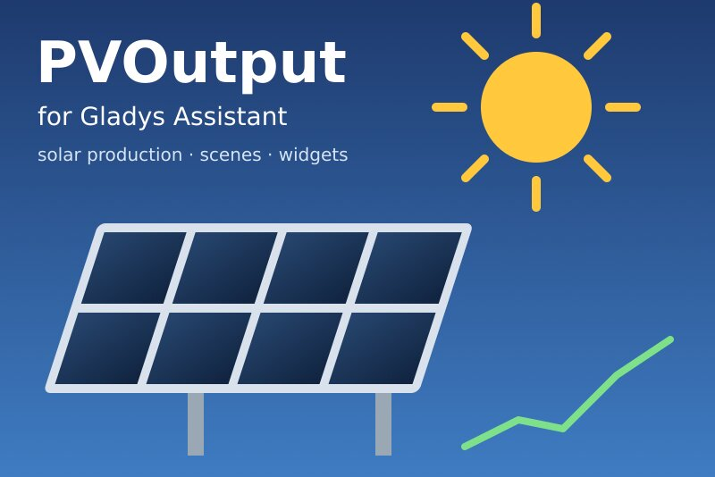
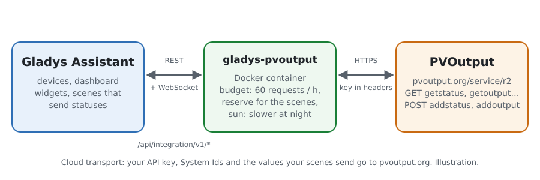
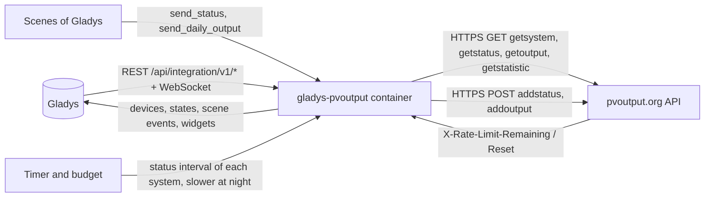
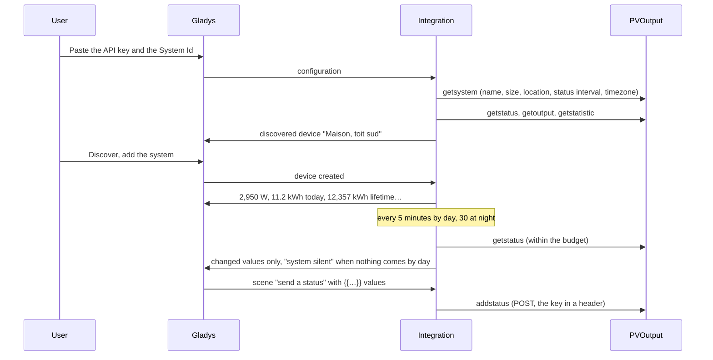
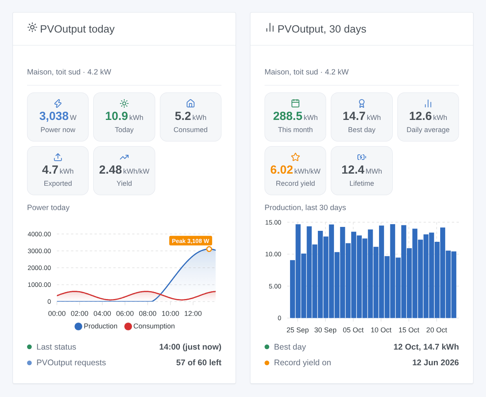

# Gladys PVOutput

**English** · [Français](README.fr.md) · [Deutsch](README.de.md) · [Español](README.es.md)

[](LICENSE)
[](https://github.com/William-De71/gladys-pvoutput/releases)
[](https://github.com/William-De71/gladys-pvoutput/actions/workflows/release.yml)
[](https://gladysassistant.com)



[Gladys Assistant](https://gladysassistant.com) external integration for [PVOutput](https://pvoutput.org), the free service where owners of solar systems share and compare their production. It brings your PVOutput systems into Gladys (production, consumption, records, daily summary) and lets your scenes send live statuses and daily outputs to PVOutput from any value of Gladys, through the official API and your own API key, within its quota of 60 requests an hour.

User documentation: [English](docs/en.md) · [Français](docs/fr.md) · [Deutsch](docs/de.md) · [Español](docs/es.md).

Not affiliated with PVOutput. **Not tested with a real PVOutput account yet**: the requests follow the official API specification, the answers and refusals are those it documents; a request with a wrong key was checked for real.

## Features

- Up to **five systems** of a PVOutput account, by their System Id, with one API key (a read only key reads; the standard key also sends).
- **One device per system**, named like it on PVOutput: power produced, energy produced today, lifetime production, and the power and energy consumed today, the temperature and the voltage when the system publishes them. A feature once found never disappears.
- **5 scene triggers** (system silent by day, system back, summary of the day after sunset, record day, key refused), **3 scene actions** (send a live status, send the output of a day, read the day of a system) and **2 dashboard widgets** (today at a system, its last 30 days).
- **Within the quota of the key**: 60 requests an hour (300 in donation mode) for every system together, a reserve kept for your scenes, the quota headers of PVOutput followed, a pause until the reset when it is reached, slower readings at night (sunrise and sunset computed at each system).
- The local time of each system: its PVOutput timezone, or the one of Gladys.
- Four languages everywhere: English, French, German, Spanish.

## How it works





From the key to a scene:



### Transport

`transports: ["cloud"]`: everything goes through `pvoutput.org`. **Your API key, your System Ids and the values your scenes send leave your network** for PVOutput; nothing else of Gladys does. The key and the System Id travel in request headers, never in a URL. `/data` keeps what getsystem said, the last status, the curve of the day, 31 days of outputs, the lifetime statistics, the requests of the last hour and what the scene triggers know — never the key.

## Devices and features

| Device         | Features (category / type)                                                                                                                                                                                                                                                                                                                                                                                             |
| -------------- | ---------------------------------------------------------------------------------------------------------------------------------------------------------------------------------------------------------------------------------------------------------------------------------------------------------------------------------------------------------------------------------------------------------------------- |
| One per system | Solar production (`energy-production-sensor` / `power`, W), production today (`energy-production-sensor` / `daily-production`, kWh), lifetime production (`energy-production-sensor` / `index`, kWh); when published: consumption (`energy-sensor` / `power`, W), consumption today (`energy-sensor` / `index-today`, kWh), temperature (`temperature-sensor` / `probe`, °C), voltage (`energy-sensor` / `voltage`, V) |

- The power falls to 0 at night and on a new day; a system late by day keeps its last value (the widget says "silent").
- The lifetime production is a **production index**: it feeds the history of Gladys, never the consumption nor the cost of the energy dashboard; it never goes down.
- The consumption of the day is `index-today`, not `daily-consumption`: Gladys would price it and count it twice with the meter of your house.
- The temperature is a `probe`: it never counts in the temperature of a room.
- No feature for the yield of the day (kWh/kW has no Gladys unit) nor for the export of the day (Gladys has no daily export type): both are in the widgets and the scenes.
- The bounds of the production features come from the size of the system (PVOutput refuses a power 50 % above it, an energy above 12 kWh/kW). External ids rest on the System Id (`ext:pvoutput:system:12345`).

## Scene triggers, actions and widgets



**Widgets**: PVOutput today (power now, live once the device exists; energy of the day; consumption or export when published; yield; the curve of the day with its peak; when the last status came, or silent, or night; requests left this hour) and PVOutput, 30 days (bars of the last 30 days, the month, the best day, the daily average, the record yield and its date, the lifetime production). The curve of the day is read only while the widget is shown, every 15 minutes at most.

**Triggers** (one event per transition, never at the first reading, never as the result of an action):

- **system silent**: no new status for 3 status intervals (30 minutes at least) **while the sun is up** at the system — inverters publish nothing at night, so the night never fires it; **system back** when it publishes again;
- **summary of the day**: once a day, about an hour after sunset at the system: production, export, consumption, peak power and time, yield, condition, record or not, and a sentence;
- **record day**: the yield of the day is the record of the life of the system (lifetime statistics of PVOutput), with the previous record;
- **key refused**: once per refusal (invalid, disabled, or not for these systems).

Filter: the system. The values (power, energy) are device features: "production above 3 kW" is a device trigger of Gladys.

**Actions**:

- **send a status** (addstatus): power and energy produced, power and energy consumed, temperature, voltage — text fields that take the `{{…}}` variables of the scene editor (Gladys 5.1.0+), numbers like `2 350` or `12,4` accepted; energies in kWh (converted to Wh) or Wh; lifetime indexes (`c1`) or net data (`n=1`); the date and time are now, in the timezone of the system. One request of the quota each time: **a scene every 5 minutes uses 12 requests an hour**.
- **send the output of a day** (addoutput): today or yesterday, production, export, consumption, peak and off-peak import (kWh, or written in Wh), min / max temperatures, condition, comment.
- **read the day of a system**: production, export, consumption, peak, yield, power now, last status and a sentence, from the last readings (no request).

Examples:

- Every 5 minutes → get the last value of the inverter power and of its production index → **PVOutput: send a status** with power `{{…}}`, energy `{{…}}`, "Production is an index".
- Every evening at 23:30 → get the Linky values of the day → **PVOutput: send the output of a day** with the export and the import.
- When **PVOutput: system silent** → send a Gladys notification "The inverter is silent since {{triggerEvent.data.last_status_time}}".
- When **PVOutput: summary of the day** → send the message "Today: {{triggerEvent.data.production_kwh}} kWh".

## Requirements

- Gladys Assistant **5.1.0** or later (widgets and scenes of integrations): older instances cannot install the integration.
- A [PVOutput](https://pvoutput.org) account (free) with **API Access** enabled and its key; the System Id of each system.
- The internet: the integration talks to `pvoutput.org` only.

### The quota of the key

PVOutput allows **60 requests an hour per API key** (300 in donation mode), and 12 getstatistic an hour (60). This counts every system and **every app using the key** — an inverter uploader using the same key shares it. The integration follows the real count PVOutput sends back: by day, for one system, about 19 requests an hour (status every 5 minutes, outputs every 30 minutes, statistics every hour, the curve while a widget shows it), fewer at night; with more systems the intervals stretch. It always keeps 15 requests an hour (60 in donation mode) for your scenes, and pauses until the reset when PVOutput says the hour is used up.

## Installation

- **From the store**: Integrations → PVOutput → Install.
- **From the repository URL**: Integrations → external integration → `https://github.com/William-De71/gladys-pvoutput`.
- **Developer mode**: run `npm start` with the variables given by Gladys (see Development).

## Configuration

| Field or button                  | Default   | Meaning                                                                                       |
| -------------------------------- | --------- | --------------------------------------------------------------------------------------------- |
| API key                          | —         | Required, a secret: Settings → API Access → Enabled → New Key; read only key for reading only |
| System Id(s)                     | —         | Required: under Registered Systems; several separated by commas, five at most                 |
| Donation mode                    | off       | 300 requests an hour instead of 60 (the answers of PVOutput correct a wrong choice)           |
| Language of the texts            | automatic | Feature names, scene texts and errors                                                         |
| Test the connection / Diagnostic | —         | Name, size, status interval, timezone, requests left; the state in the logs, without the key  |

## Usage

1. On pvoutput.org: Settings → API Access → **Enabled** → **New Key** → Save; note the **System Id** under Registered Systems.
2. In Gladys (Integrations → PVOutput → Configuration): paste the key and the System Id(s); press **Test the connection**.
3. **Discover**, then add your systems as devices.
4. Add the widgets to a dashboard, and build scenes with the features, the triggers and the actions.

## Development

```bash
npm install
npm test                       # node --test, a fake PVOutput on 127.0.0.1, never the network
npm run lint                   # ESLint
npm run format:check           # Prettier
npx github:GladysAssistant/integration-store . --skip-image-check
scripts/build-cover.sh         # cover.jpg from docs/assets/cover.svg
docs/illustrations/render.sh   # docs/assets/widgets.<lang>.png
```

Locally, the SDK reads `GLADYS_HOST_API_URL`, `GLADYS_INTEGRATION_TOKEN` and `GLADYS_INTEGRATION_SELECTOR` (given by Gladys in developer mode), and the integration reads `TZ`. `DEBUG=gladys-integration-sdk` shows the SDK logs.

The tests cover the HTTP client (headers, GET and POST, every refusal of the specification), the parser (the examples of the specification, NaN, a comma in a name, the hour repeated when the clocks go back), the timezones and the sun, the budget (reserve, headers, pause, stretch), the scene actions (numbers, units, `c1` / `n`, refusals), the triggers (silence by day only, one summary a day, records), the devices (the fields the Discovery screen requires), the widgets (`validateWidgetContent`), the manifest, the four languages, the release script, and the whole integration against the fake Gladys of the SDK and a fake PVOutput HTTP server. `test/structure.test.js` freezes every key users store.

## Release process


Every merge on `main` runs the CI, then computes the version from the [Conventional Commits](https://www.conventionalcommits.org/) since the last tag: `feat` → minor, `fix` / `perf` → patch, `!` or `BREAKING CHANGE` → major (a minor below 1.0.0); `docs`, `chore`, `ci`, `test`, `style`, `refactor`, `build` alone publish nothing. The changelog section is generated, the tag pushed, the multi-architecture image built, then `main` receives the release commit, the GitHub Release is created and a last job checks the public image, the store validator and the topic.

- The pull request title becomes the squash commit, then the changelog line: write it in English, for the user (`pr-title.yml` checks it). Never edit `CHANGELOG.md` by hand.
- 1.0.0 is a decision: Actions → Release → Run workflow with `release-as: 1.0.0`. `dry-run` shows the version and the notes without publishing.
- **Protected branch**: the release pushes its commit to `main` with `GITHUB_TOKEN`. The `protect-main` ruleset (no deletion, no force-push) lets it through; a stricter rule (pull request required, status checks) would need GitHub Actions in its bypass list, or a GitHub App.
- After the first release, make the `ghcr.io` package public (Package settings → Change visibility), or Gladys cannot pull it.

## Troubleshooting

See [docs/en.md](docs/en.md#troubleshooting). Report issues with the versions of Gladys and of the integration, the message of **Test the connection** and the result of **Diagnostic** (in the logs of the integration). Never paste your key.

## Contributing

Issues and pull requests are welcome. Run `npm run format:check && npm run lint && npm test` before opening a pull request, and keep every external id and stored key unchanged (see [CLAUDE.md](CLAUDE.md)).

## Security

See [SECURITY.md](SECURITY.md): report vulnerabilities privately. The key is a `secret` field: never logged, never written to `/data`, sent only to `pvoutput.org` in a request header, never in a URL.

## Screenshots to come

The images above are illustrations, not screenshots. Real screenshots will go in `docs/assets/screenshots/` (PNG, 1280 × 800): `configuration.png`, `discovery.png`, `device.png` (a system with its features), `scene-send-status.png` (the "send a status" action with `{{…}}` variables).

## License

[Apache License 2.0](LICENSE) — see also [NOTICE](NOTICE). The data belong to the owners of the systems; PVOutput.org is run by its own authors. Thanks to the Gladys documentation and SDK, and to PVOutput for its open API.
